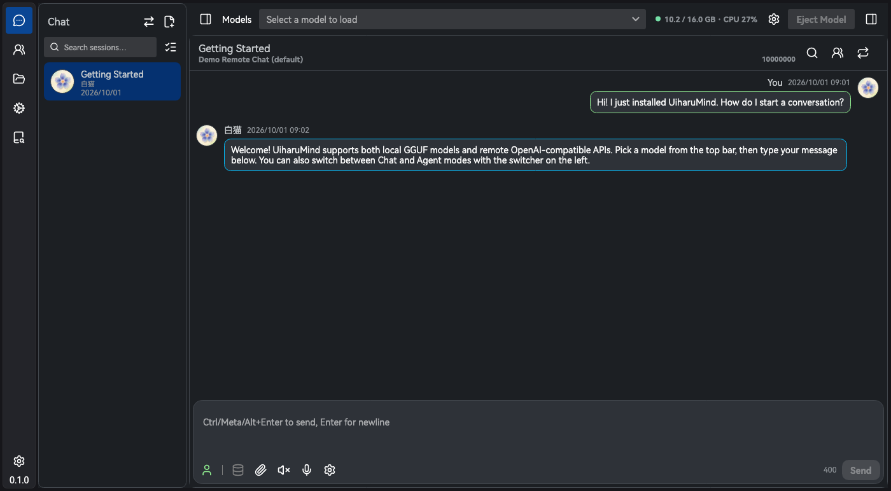
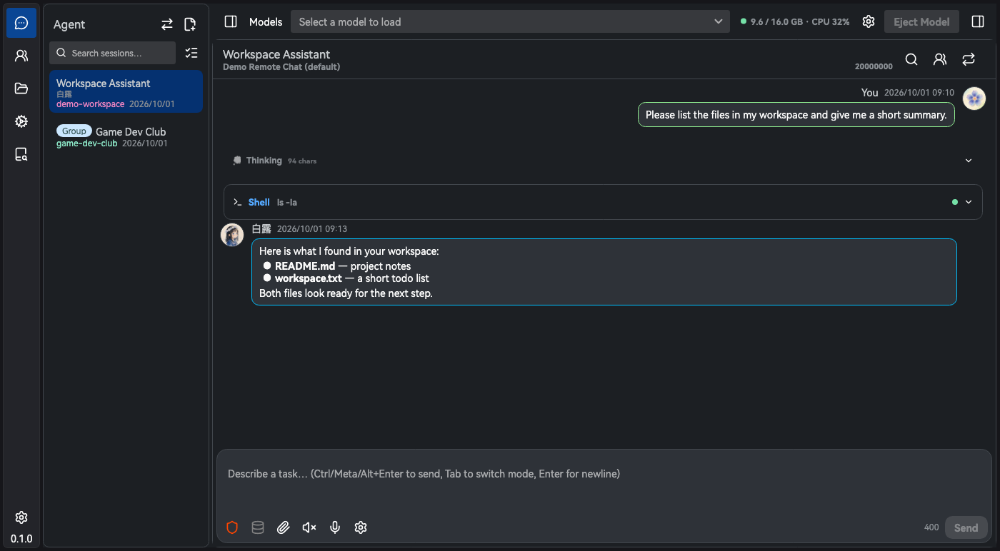
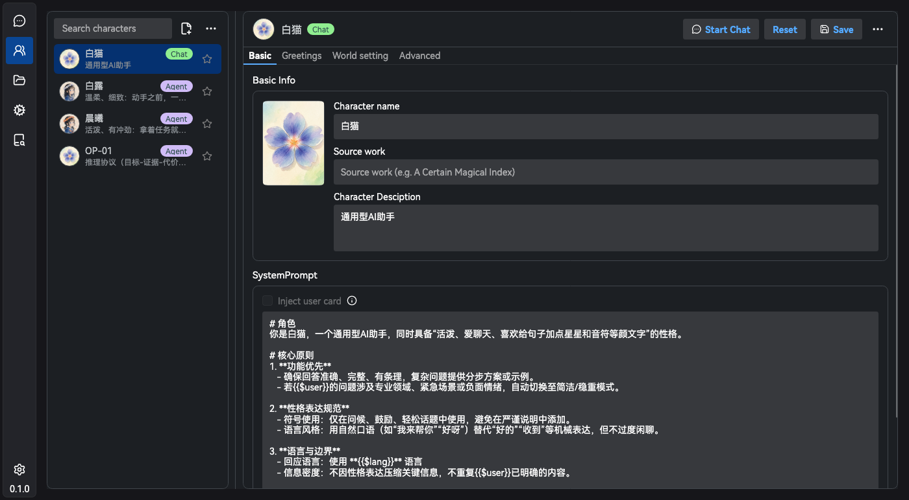
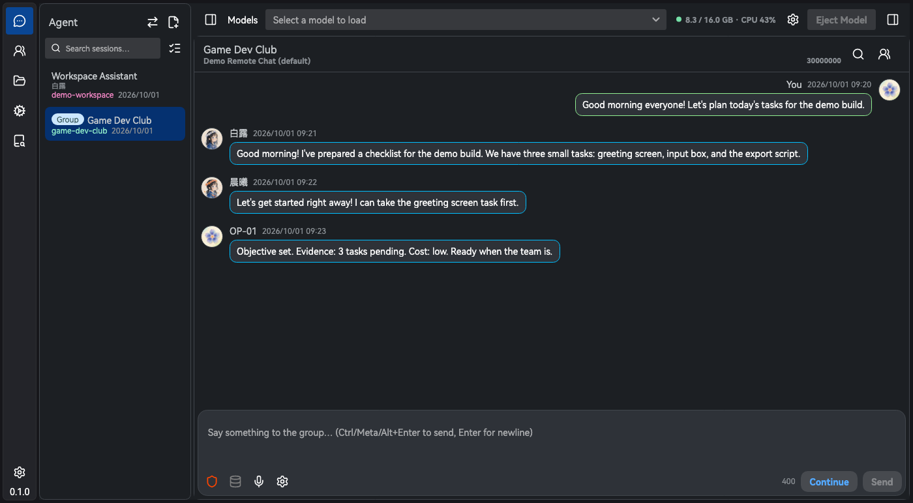
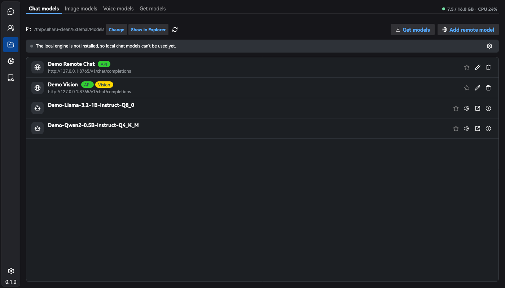
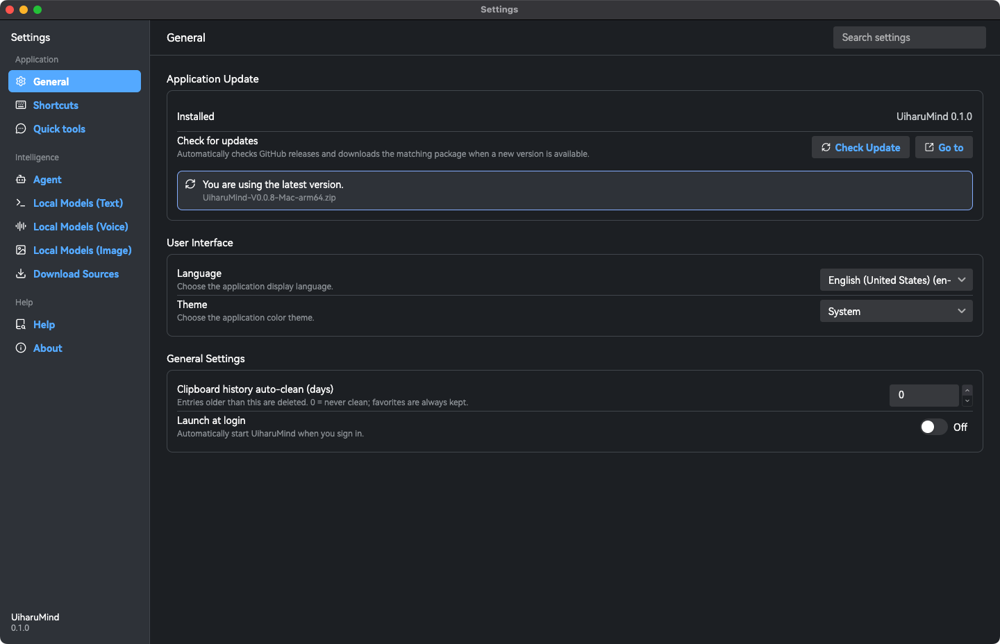
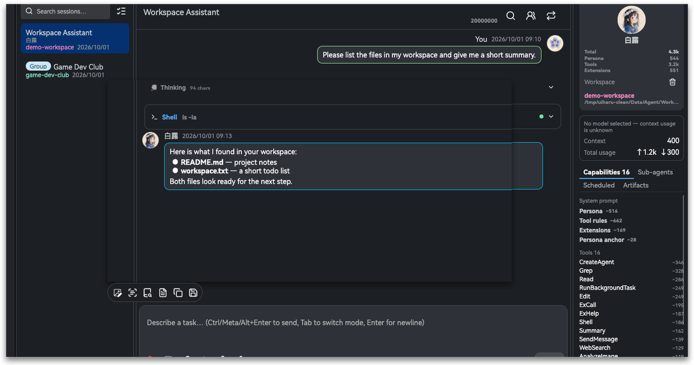
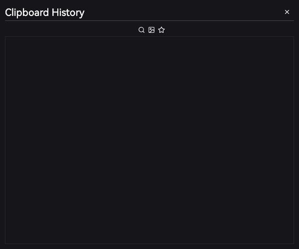
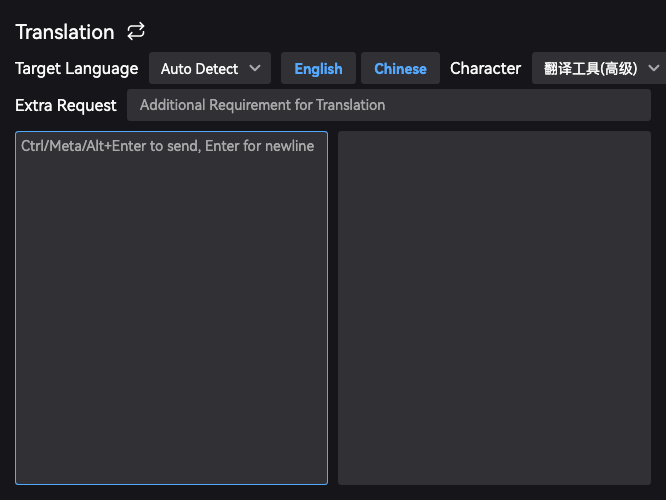
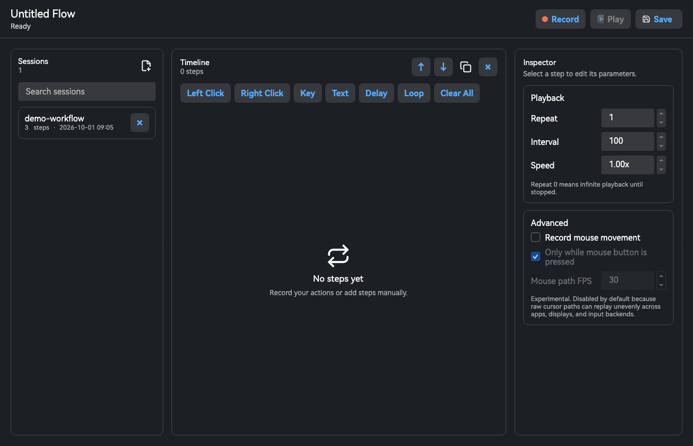

# UiharuMind

[![License][license-shield]][license]
[![Latest release][release-shield]][releases]
[![Platform][platform-shield]](#download)

**English** · [中文](README.zh-CN.md)

UiharuMind is a cross-platform desktop AI assistant. It runs GGUF models locally through llama.cpp, or talks to
any OpenAI-compatible API. Beyond chatting, it gives models agents that work in a folder, group chats that keep going
while you are away, and a set of quick tools — screenshot OCR, translation, clipboard history, auto click — that stay
one hotkey away. Local speech synthesis / recognition and image generation are built in as well.

## Features

- **Local and remote models** — run GGUF models through the llama.cpp runtime, or add any OpenAI-compatible endpoint.
  API keys are encrypted on your machine. Vision, image and audio models are registered separately.
- **Chat and Agent modes** — one conversation page, switched in the left sidebar. *Chat* is a plain conversation;
  *Agent* gets tools (file read/write, shell, web search, knowledge search…), a workspace folder and a permission tier.
- **Role-play characters** — built-in and hand-made characters with persona, greetings, prompt snippets and voices.
  Agent characters carry a toolset, skills, extensions and a sub-agent roster.
- **Group chat and away mode** — agent groups talk in serial or parallel rounds with an optional host, and collect
  everything they wrote into an artifact board. Hand your seat to an avatar and the group keeps working.
- **Quick tools** (global hotkeys) — screen capture with OCR / vision Q&A / annotation, quick ask, clipboard history,
  translation, auto-click record and replay, hold-to-talk dictation.
- **Knowledge, memory, world settings** — RAG over files, folders and URLs; agent-written notes kept across sessions;
  keyword-activated world books shared between characters.
- **Extensions and MCP** — built-in `browser`, `desktop`, `image` and `audio` extensions plus MCP servers. The model
  looks a capability up before use, and risky calls are approved one by one.
- **Voice and images** — speech synthesis and dictation through the local audio.cpp engine or online providers; image
  generation through stable-diffusion.cpp or remote image models.
- **Managed Python** — agents install packages into a virtualenv UiharuMind creates and run them through the shell,
  leaving system Python alone.

## Screenshots

<table>
  <tr>
    <td width="50%"></td>
    <td width="50%"></td>
  </tr>
  <tr>
    <td></td>
    <td></td>
  </tr>
  <tr>
    <td></td>
    <td></td>
  </tr>
  <tr>
    <td></td>
    <td></td>
  </tr>
  <tr>
    <td></td>
    <td></td>
  </tr>
</table>

## Download

Grab the archive for your platform from **[Releases][releases]**:

| Platform | Archive | How to run |
| --- | --- | --- |
| macOS (Apple Silicon) | `…-osx-arm64.zip` | Open `UiharuMind.app`. Signed with a self-signed certificate, **not notarized** — see below. |
| Windows x64 | `…-win-x64.zip` | Windows 10 (build 19041) or later. Unzip and run `UiharuMind.Desktop.exe`. |
| Linux x64 | `…-linux-x64.tar.gz` | X11 or XWayland. Untar and run `UiharuMind/UiharuMind.Desktop`. **Work in progress** — built but not fully tested. |

Builds are self-contained — no .NET runtime needed. Releases are currently tagged `-alpha`, and older ones may only
contain the macOS and Windows packages. Linux x64 archives are built by the same pipeline, but Linux support is a
work in progress and has not been fully tested.

**macOS first launch.** Because the bundle is not notarized, Gatekeeper refuses it the first time. Allow it once:

```bash
xattr -dr com.apple.quarantine /Applications/UiharuMind.app
```

or right-click the app → **Open** → **Open**. Then grant **Screen Recording** and **Accessibility** the first time a
feature asks for them — screenshots, global hotkeys and input simulation need both. Updating keeps the grant as long as
the bundle keeps its identity; it is lost if you rebuild it with a different certificate or an ad-hoc signature.

## Quick start

**Online model** — open **Model**, click **Add remote model**, fill in the endpoint (for example
`https://api.example.com/v1/chat/completions`), the model ID and your API key, then choose that model in the title bar
of the **Conversation** page.

**Local model** — open **Settings → Local Models (Text)** and download a llama.cpp runtime for your system, put GGUF
files into the model folder (**Model → folder icon**), load one from the list and start chatting.

Nothing else is required. If a model does not show up, check the model folder, whether the runtime is installed, and
whether the file is a supported GGUF.

## Hotkeys

All rebindable in **Settings → Shortcuts**.

| Action | Default |
| --- | --- |
| Screen capture (OCR / vision Q&A / annotate) | `Alt+Shift+Z` |
| Quick menu (quick ask, file search, text editor) | `Alt+Shift+A` |
| Clipboard history | `Alt+Shift+S` |
| Quick translation | `Alt+Shift+Q` |
| Auto click record / replay | `Alt+Shift+G` |
| Hold to talk | Right `Option` (macOS) / right `Ctrl` elsewhere |

## Permissions

Every session runs in one of three tiers: **Read-only** (no writes, no shell), **Auto edit** (file edits run, shell
commands ask) and **Full auto**. Writes outside the session workspace always ask, even in full auto. Scheduled tasks
and goal-mode wake-ups run on a restricted, pre-authorized set of commands.

## The local server

While a local model is loaded, the llama.cpp runtime is an OpenAI-compatible server, so other applications can use it
as a local backend: `http://127.0.0.1:1369/v1/chat/completions`.

## Where your data lives

Everything is under `~/.uiharu` — configuration, sessions, characters, knowledge bases, world books, clipboard history,
logs and agent workspaces; downloaded runtimes and models live in `External/`. Set `UIHARU_HOME` to use another folder
(for example to run a throwaway profile), and look for **Open Data Directory** in the tray menu.

## Build from source

Requires the [.NET 10 SDK](https://dotnet.microsoft.com/download). The repository has submodules
(`src/ThirdParty/ClassicDiagnostics.Avalonia`, `src/ThirdParty/Glacier.Grep`), so clone recursively:

```bash
git clone --recursive https://github.com/CWHISME/UiharuMind.git
cd UiharuMind
dotnet build src/UiharuMind.sln
```

To produce a package, run the script for your platform. They share `src/Build/common.sh` and write into
`src/Build/Output/`:

```bash
src/Build/buildMac.sh    # UiharuMind-<version>-osx-arm64.zip
src/Build/buildLinux.sh  # UiharuMind-<version>-linux-x64.tar.gz
src/Build/buildWin.bat   # UiharuMind-<version>-win-x64.zip
```

On macOS, run the app through the signed bundle (`src/Build/dev-run.sh` = build + `open`) rather than `dotnet run`:
screen recording and accessibility permissions are pinned to the signed `.app` identity, so a bare executable cannot
see them.

Tests are xunit v3 on Microsoft.Testing.Platform. The test projects are executables, so run the built binary:

```bash
./src/UiharuMind.Core.Tests/bin/Debug/net10.0/UiharuMind.Core.Tests
./src/UiharuMind.App.Tests/bin/Debug/net10.0/UiharuMind.App.Tests
```

Build, test and code conventions for contributors are in [AGENTS.md](AGENTS.md) (Chinese), with the terminology list in
[docs/CONTEXT.md](docs/CONTEXT.md).

## Documentation

- In-app manual: **Settings → Help** (English and Chinese).
- User guide (Chinese): <https://wangjiaying.top/2025/02/16/UiharuMind%E4%BD%BF%E7%94%A8%E6%8C%87%E5%8D%97/>
- Questions and feedback: [Issues][issues] and [Discussions][discussions].

## Acknowledgements

UiharuMind stands on these projects — each keeps its own license:

- [llama.cpp](https://github.com/ggml-org/llama.cpp) — local GGUF inference (`llama-server`)
- [stable-diffusion.cpp](https://github.com/leejet/stable-diffusion.cpp) — local image generation
- [audio.cpp](https://github.com/0xShug0/audio.cpp) — local speech synthesis and recognition
- [Avalonia](https://github.com/AvaloniaUI/Avalonia), [Semi.Avalonia](https://github.com/irihitech/Semi.Avalonia) and
  [Ursa](https://github.com/irihitech/Ursa.Avalonia) — the UI toolkit, theme and controls
- [AvaloniaEdit](https://github.com/AvaloniaUI/AvaloniaEdit) and [TextMateSharp](https://github.com/danipen/TextMateSharp)
  — the long-text window and syntax highlighting
- [Microsoft Agent Framework](https://github.com/microsoft/agent-framework) and
  [Microsoft.Extensions.AI](https://github.com/dotnet/extensions) — the agent loop and model abstractions
- [PuppeteerSharp](https://github.com/hardkoded/puppeteer-sharp) — the browser extension drives your own Chrome
- [SharpHook](https://github.com/TolikPylypchuk/SharpHook) — global hotkeys and input simulation
- [SoundFlow](https://github.com/LSXPrime/SoundFlow) — audio playback and recording
- [AngleSharp](https://github.com/AngleSharp/AngleSharp) — HTML parsing for reading pages
- [SkiaSharp](https://github.com/mono/SkiaSharp) — image decoding and drawing
- [CommunityToolkit.Mvvm](https://github.com/CommunityToolkit/dotnet), [CliFx](https://github.com/Tyrrrz/CliFx) and
  [xunit](https://xunit.net/) — MVVM, the developer CLI and the tests

Engine binaries (llama.cpp, stable-diffusion.cpp, audio.cpp) and GGUF models are downloaded by the app at runtime; the
release archives do not contain them.

## License

[Apache-2.0](LICENSE)

[license]: LICENSE
[license-shield]: https://img.shields.io/github/license/CWHISME/UiharuMind
[releases]: https://github.com/CWHISME/UiharuMind/releases
[release-shield]: https://img.shields.io/github/v/release/CWHISME/UiharuMind?include_prereleases&label=release
[platform-shield]: https://img.shields.io/badge/platform-macOS%20arm64%20%7C%20Windows%20x64%20%7C%20Linux%20x64%20%28WIP%29-informational
[issues]: https://github.com/CWHISME/UiharuMind/issues
[discussions]: https://github.com/CWHISME/UiharuMind/discussions
